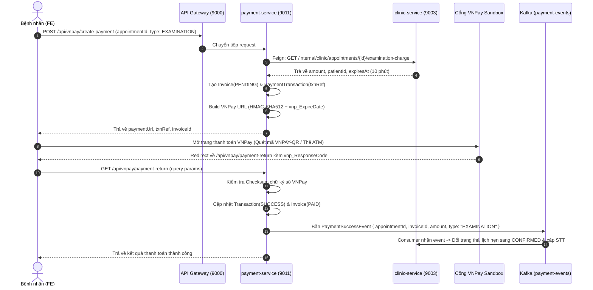
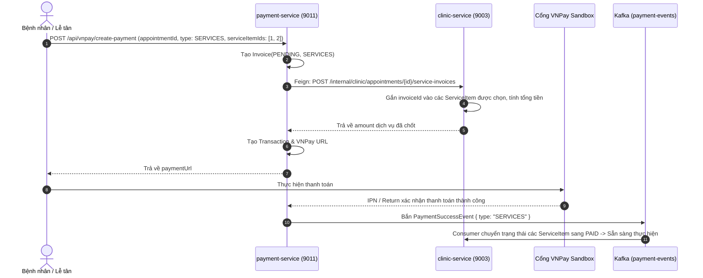

# TÀI LIỆU CHI TIẾT API - PAYMENT-SERVICE (DỊCH VỤ THANH TOÁN & HÓA ĐƠN VNPAY)

## 1. TỔNG QUAN SERVICE (SERVICE OVERVIEW)

- **Tên Service:** `payment-service`
- **Cổng dịch vụ trực tiếp (Port):** `9011`
- **Cổng thông qua API Gateway:** `9000` (được định tuyến qua `http://localhost:9000/api/vnpay/**` và `http://localhost:9000/api/payments/**`)
- **Cơ sở dữ liệu:** PostgreSQL (`jdbc:postgresql://localhost:5432/payment_service`)
- **Cổng thanh toán tích hợp:** VNPAY Sandbox / Production (Chuẩn giao thức VNPay 2.1.0, mã hóa SHA-512)
- **Message Broker:** Apache Kafka (`localhost:9092`)
  - **Producer Topic:** `payment-events`
  - **Payload Event:** `PaymentSuccessEvent` (Bắn sự kiện sang `clinic-service` khi giao dịch thành công)
- **Discovery Service:** Netflix Eureka (`http://localhost:8761/eureka/`)
- **Giao tiếp liên dịch vụ (Inter-service Communication):**
  - **Gọi sang `clinic-service`** qua OpenFeign (`ClinicClient`):
    - `GET /internal/clinic/appointments/{id}/examination-charge`: Lấy tiền công khám đã chốt.
    - `POST /internal/clinic/appointments/{id}/service-invoices`: Gắn mã hóa đơn cho dịch vụ chỉ định.
    - `GET /internal/clinic/appointments/{id}/services`: Lấy danh sách dịch vụ chi tiết của ca khám.
  - **Cung cấp dữ liệu cho `statistic-service`** qua `InternalStatisticController`:
    - Báo cáo tổng quan doanh thu theo tháng, biểu đồ doanh thu theo ngày/tháng, tổng kết thanh toán và top ngân hàng.

---

### 1.1. Mô hình Hóa đơn & Giao dịch (Billing Model)
1. **Invoice (Hóa đơn):** Đại diện cho một khoản tiền cần thanh toán của lịch hẹn khám nha khoa:
   - `EXAMINATION`: Tiền công khám bác sĩ ban đầu (giữ chỗ khám).
   - `SERVICES`: Tiền các dịch vụ nha khoa cận lâm sàng (chụp X-quang, nhổ răng, trám răng, cấy ghép...).
   - Trạng thái: `PENDING` (chờ thanh toán), `PAID` (đã thanh toán), `CANCELLED` (đã hủy).
2. **PaymentTransaction (Giao dịch thanh toán):** Mỗi lần người dùng nhấn thanh toán sẽ sinh ra một `PaymentTransaction` độc nhất (`txnRef`) gắn với `Invoice`. 
   - Quan hệ **1 Invoice có thể có nhiều Transactions** (trường hợp người dùng thử thanh toán nhiều lần hoặc đổi ngân hàng).
   - Trạng thái: `PENDING` (chờ VNPay xử lý), `SUCCESS` (thành công), `FAILED` (thất bại).

---

## 2. QUY CHUẨN DỮ LIỆU CHUNG (STANDARDS & CONVENTIONS)

### 2.1. Cấu trúc Response chuẩn (`ApiResponse<T>`)
```json
{
  "code": 200,
  "message": "Thông điệp phản hồi (nếu có)",
  "result": { ... }
}
```

### 2.2. Trạng thái Hóa đơn (`InvoiceStatus`)
| Giá trị | Ý nghĩa nghiệp vụ |
| :--- | :--- |
| `PENDING` | Hóa đơn mới tạo, đang chờ bệnh nhân hoàn tất giao dịch qua cổng VNPay. |
| `PAID` | Đã nhận callback/IPN hợp lệ từ VNPay xác nhận thanh toán thành công. |
| `CANCELLED` | Hóa đơn bị hủy (do tạo hóa đơn dịch vụ mới hoặc ca khám bị hủy). |

### 2.3. Loại Hóa đơn (`InvoiceType`)
| Giá trị | Ý nghĩa |
| :--- | :--- |
| `EXAMINATION` | Hóa đơn thanh toán tiền công khám ca trực bác sĩ ban đầu (để xác nhận lịch hẹn). |
| `SERVICES` | Hóa đơn thanh toán các dịch vụ nha khoa cận lâm sàng do bác sĩ chỉ định trong ca khám. |

### 2.4. Trạng thái Giao dịch VNPay (`TransactionStatus`)
| Giá trị | Ý nghĩa |
| :--- | :--- |
| `PENDING` | Đang chuyển hướng sang cổng thanh toán VNPay. |
| `SUCCESS` | VNPay xác nhận giao dịch thành công (Mã phản hồi `vnp_ResponseCode = 00`). |
| `FAILED` | Giao dịch thất bại, người dùng hủy, hết hạn hoặc tài khoản không đủ tiền. |

### 2.5. Bảng mã phản hồi phổ biến của VNPay (`vnp_ResponseCode`)
| Mã VNPay | Ý nghĩa |
| :--- | :--- |
| `00` | Giao dịch thành công. |
| `07` | Trừ tiền thành công, giao dịch bị nghi ngờ gian lận (cần kiểm tra). |
| `09` | Thẻ/Tài khoản chưa đăng ký dịch vụ Internet Banking tại ngân hàng. |
| `10` | Khách hàng xác thực thông tin thẻ/tài khoản không đúng quá 3 lần. |
| `11` | Đã hết hạn chờ thanh toán (Quá thời gian `vnp_ExpireDate`). |
| `24` | Khách hàng hủy giao dịch trên giao diện thanh toán VNPay. |
| `51` | Tài khoản của quý khách không đủ số dư để thực hiện giao dịch. |
| `97` | Chữ ký điện tử không hợp lệ (Sai checksum SHA-512). |

---

## 3. KIẾN TRÚC & QUY TRÌNH THANH TOÁN (WORKFLOW DIAGRAMS)

### 3.1. Quy trình Thanh toán Tiền công khám (`EXAMINATION`)


---

### 3.2. Quy trình Thanh toán Dịch vụ chỉ định (`SERVICES`)


---

## 4. CHI TIẾT DANH SÁCH API THANH TOÁN (PAYMENT APIS)

### API 1: Khởi tạo URL Thanh toán VNPay
- **Mục đích:** Tạo giao dịch thanh toán cho lịch hẹn nha khoa (tiền khám hoặc tiền dịch vụ cận lâm sàng), sinh mã giao dịch duy nhất và URL chuyển hướng sang VNPay.
- **Phương thức:** `POST`
- **Đường dẫn Gateway:** `http://localhost:9000/api/vnpay/create-payment` (hoặc `http://localhost:9000/api/payments/create-payment`)
- **Yêu cầu xác thực:** Đã đăng nhập (`USER`, `PATIENT`, `ADMIN`).
- **Headers:**
  ```http
  Authorization: Bearer <accessToken>
  Content-Type: application/json
  ```
- **Request Body:**
  ```json
  {
    "appointmentId": 105,
    "type": "EXAMINATION",
    "serviceItemIds": []
  }
  ```
  *Hoặc thanh toán dịch vụ chỉ định:*
  ```json
  {
    "appointmentId": 105,
    "type": "SERVICES",
    "serviceItemIds": [12, 13]
  }
  ```
- **Response mẫu (200 OK):**
  ```json
  {
    "code": 200,
    "message": null,
    "result": {
      "paymentUrl": "https://sandbox.vnpayment.vn/paymentv2/vpcpay.html?vnp_Amount=15000000&vnp_Command=pay&vnp_CreateDate=20261028114500&vnp_CurrCode=VND&vnp_ExpireDate=20261028115500&vnp_IpAddr=127.0.0.1&vnp_Locale=vn&vnp_OrderInfo=Thanh+toan+hoa+don+%2342&vnp_OrderType=other&vnp_ReturnUrl=http%3A%2F%2Flocalhost%3A9000%2Fapi%2Fvnpay%2Fpayment-return&vnp_TmnCode=DEMO1234&vnp_TxnRef=TXN42T1730101500000&vnp_Version=2.1.0&vnp_SecureHash=a9b8c7...",
      "orderId": "TXN42T1730101500000",
      "txnRef": "TXN42T1730101500000",
      "invoiceId": 42,
      "amount": 150000,
      "message": "Tạo URL thanh toán thành công"
    }
  }
  ```

---

### API 2: Xử lý Callback khi Trình duyệt chuyển hướng về (`Payment Return`)
- **Mục đích:** Nhận các tham số phản hồi từ VNPay khi người dùng hoàn tất thanh toán trên trình duyệt, kiểm tra chữ ký SHA-512, cập nhật trạng thái hóa đơn và bắn Kafka event.
- **Phương thức:** `GET`
- **Đường dẫn Gateway:** `http://localhost:9000/api/vnpay/payment-return`
- **Yêu cầu xác thực:** Public (Gọi tự động từ trình duyệt người dùng sau khi rời VNPay).
- **Query Parameters từ VNPay:**
  - `vnp_TxnRef`: Mã tham chiếu giao dịch đã tạo.
  - `vnp_Amount`: Số tiền giao dịch (đã nhân 100).
  - `vnp_ResponseCode`: `00` (thành công) hoặc mã lỗi.
  - `vnp_TransactionNo`: Mã giao dịch do VNPay cấp.
  - `vnp_BankCode`: Mã ngân hàng thực hiện (NCB, VCB, MB...).
  - `vnp_PayDate`: Thời gian thanh toán (yyyyMMddHHmmss).
  - `vnp_SecureHash`: Chữ ký số kiểm tra toàn vẹn.
- **Response mẫu (200 OK):**
  ```json
  {
    "code": 200,
    "message": null,
    "result": {
      "success": true,
      "orderId": "TXN42T1730101500000",
      "amount": 150000,
      "orderInfo": "Thanh toan hoa don #42",
      "responseCode": "00",
      "transactionId": "14589234",
      "bankCode": "NCB",
      "payDate": "20261028114630",
      "invoiceId": 42,
      "message": "Giao dịch thành công"
    }
  }
  ```

---

### API 3: Webhook IPN xử lý thông báo máy chủ (`Payment IPN`)
- **Mục đích:** Tiếp nhận thông báo tức thời từ máy chủ VNPay độc lập với trình duyệt (đảm bảo cập nhật giao dịch ngay cả khi người dùng tắt trình duyệt giữa chừng).
- **Phương thức:** `GET`
- **Đường dẫn:** `http://localhost:9000/api/vnpay/payment-ipn`
- **Yêu cầu xác thực:** Public (VNPay Server gọi trực tiếp).
- **Response chuẩn theo quy định của VNPay:**
  ```json
  {
    "RspCode": "00",
    "Message": "Confirm Success"
  }
  ```
  *(Nếu sai chữ ký: trả về `{"RspCode": "97", "Message": "Invalid signature"}`)*

---

### API 4: Tra cứu Hóa đơn theo Lịch hẹn khám
- **Mục đích:** Lấy toàn bộ danh sách hóa đơn (tiền khám và tiền dịch vụ) của một lịch hẹn kèm chi tiết các dịch vụ nha khoa liên kết.
- **Phương thức:** `GET`
- **Đường dẫn Gateway:** `http://localhost:9000/api/vnpay/appointments/{appointmentId}/invoices`
- **Yêu cầu xác thực:** Bệnh nhân sở hữu lịch hẹn hoặc `ADMIN`.
- **Headers:** `Authorization: Bearer <accessToken>`
- **Response mẫu (200 OK):**
  ```json
  {
    "code": 200,
    "message": null,
    "result": [
      {
        "id": 42,
        "appointmentId": 105,
        "patientId": 25,
        "type": "EXAMINATION",
        "amount": 150000,
        "status": "PAID",
        "createdAt": "2026-10-28T04:45:00Z",
        "paidAt": "2026-10-28T04:46:30Z",
        "services": []
      },
      {
        "id": 43,
        "appointmentId": 105,
        "patientId": 25,
        "type": "SERVICES",
        "amount": 350000,
        "status": "PENDING",
        "createdAt": "2026-10-28T05:10:00Z",
        "paidAt": null,
        "services": [
          {
            "id": 12,
            "serviceName": "Chụp phim quanh chóp kỹ thuật số",
            "price": 150000,
            "quantity": 1,
            "status": "PENDING"
          },
          {
            "id": 13,
            "serviceName": "Cạo vôi răng & Đánh bóng 2 hàm",
            "price": 200000,
            "quantity": 1,
            "status": "PENDING"
          }
        ]
      }
    ]
  }
  ```

---

### API 5: Quản lý Tất cả Hóa đơn (Dành cho Quản trị viên)
- **Mục đích:** Danh sách tổng hợp hóa đơn toàn chuỗi nha khoa, hỗ trợ lọc theo trạng thái và phân trang.
- **Phương thức:** `GET`
- **Đường dẫn Gateway:** `http://localhost:9000/api/vnpay/invoices?status=PAID&page=0&size=10&sort=createdAt,desc`
- **Quyền hạn:** `ROLE_ADMIN`
- **Query Parameters:**
  - `status`: `PENDING`, `PAID`, `CANCELLED` (Tùy chọn)
  - `page`: Số trang (bắt đầu từ 0)
  - `size`: Kích thước trang
  - `sort`: Trường sắp xếp (`createdAt,desc`)
- **Response mẫu (200 OK):**
  ```json
  {
    "code": 200,
    "message": null,
    "result": {
      "content": [
        {
          "id": 42,
          "appointmentId": 105,
          "patientId": 25,
          "type": "EXAMINATION",
          "amount": 150000,
          "status": "PAID",
          "createdAt": "2026-10-28T04:45:00Z",
          "paidAt": "2026-10-28T04:46:30Z"
        }
      ],
      "totalPages": 15,
      "totalElements": 142,
      "size": 10,
      "number": 0
    }
  }
  ```

---

### API 6: Xem Lịch sử Giao dịch chi tiết của một Hóa đơn
- **Mục đích:** Quản trị viên kiểm tra nhật ký tất cả các lần thử thanh toán qua VNPay của hóa đơn đó (mã VNPay, ngân hàng, thời gian thanh toán, mã lỗi nếu có).
- **Phương thức:** `GET`
- **Đường dẫn Gateway:** `http://localhost:9000/api/vnpay/invoices/{invoiceId}/transactions`
- **Quyền hạn:** `ROLE_ADMIN`
- **Response mẫu (200 OK):**
  ```json
  {
    "code": 200,
    "message": null,
    "result": [
      {
        "id": 88,
        "invoiceId": 42,
        "txnRef": "TXN42T1730101400000",
        "amount": 150000,
        "paymentMethod": "VNPAY",
        "status": "FAILED",
        "vnpTransactionNo": null,
        "bankCode": "NCB",
        "payDate": null,
        "responseCode": "24",
        "createdAt": "2026-10-28T04:43:20Z"
      },
      {
        "id": 89,
        "invoiceId": 42,
        "txnRef": "TXN42T1730101500000",
        "amount": 150000,
        "paymentMethod": "VNPAY",
        "status": "SUCCESS",
        "vnpTransactionNo": "14589234",
        "bankCode": "NCB",
        "payDate": "20261028114630",
        "responseCode": "00",
        "createdAt": "2026-10-28T04:45:00Z"
      }
    ]
  }
  ```

---

## 5. CÁC API NỘI BỘ DÀNH CHO STATISTIC-SERVICE (`/internal/payment/statistics/**`)

Dưới đây là các API nội bộ không public ra Internet, phục vụ `statistic-service` gọi qua OpenFeign:

| Phương thức | Đường dẫn nội bộ | Mục đích nghiệp vụ |
| :--- | :--- | :--- |
| `GET` | `/internal/payment/statistics/revenue-overview?month=10&year=2026` | Trả về tổng doanh thu tháng, tách riêng tiền khám và tiền dịch vụ nha khoa. |
| `GET` | `/internal/payment/statistics/revenue?from=2026-10-01&to=2026-10-31&groupBy=DAY` | Biểu đồ chuỗi thời gian doanh thu gom theo ngày hoặc tháng. |
| `GET` | `/internal/payment/statistics/summary?from=2026-10-01&to=2026-10-31` | Thống kê số lượng hóa đơn, tỷ lệ thanh toán thành công và top ngân hàng sử dụng. |

---

## 6. ĐẶC TẢ KAFKA PRODUCER EVENT (`PaymentSuccessEvent`)

Khi giao dịch thanh toán được xác minh thành công, `payment-service` bắn sự kiện lên Kafka:

- **Topic:** `payment-events`
- **Key:** `String.valueOf(appointmentId)` (Đảm bảo thứ tự sự kiện theo từng ca khám)
- **Cấu trúc JSON Payload:**
```json
{
  "appointmentId": 105,
  "invoiceId": 42,
  "patientId": 25,
  "type": "EXAMINATION",
  "amount": 150000,
  "txnRef": "TXN42T1730101500000",
  "vnpTransactionNo": "14589234",
  "paidAt": "2026-10-28T04:46:30Z"
}
```
- **Xử lý phía `clinic-service`:**
  - Nếu `type == "EXAMINATION"`: Chuyển lịch hẹn sang `CONFIRMED`, cấp số thứ tự khám (`queueNumber`).
  - Nếu `type == "SERVICES"`: Chuyển các dịch vụ cận lâm sàng liên kết sang `PAID` để bác sĩ/kỹ thuật viên tiến hành chụp phim hoặc điều trị.

